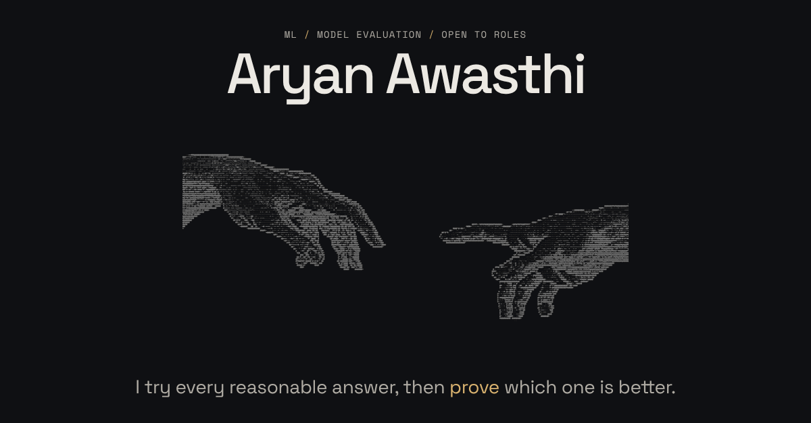

<p align="center">
  <a href="https://aryanawasthi.vercel.app/"></a>
</p>

<p align="center"><a href="https://aryanawasthi.vercel.app/"><b>Open the live site</b></a></p>

# Portfolio

Personal portfolio of Aryan Awasthi: machine learning, model evaluation and data.

```
      .o.       ooooooooo.   oooooo   oooo       .o.       ooooo      ooo
     .888.      `888   `Y88.  `888.   .8'       .888.      `888b.     `8'
    .8"888.      888   .d88'   `888. .8'       .8"888.      8 `88b.    8
   .8' `888.     888ooo88P'     `888.8'       .8' `888.     8   `88b.  8
  .88ooo8888.    888`88b.        `888'       .88ooo8888.    8     `88b.8
 .8'     `888.   888  `88b.       888       .8'     `888.   8       `888
o88o     o8888o o888o  o888o     o888o     o88o     o8888o o8o        `8
```

A single static page with no framework and no build step at runtime.

## Files

| Path | What it is |
|:--|:--|
| `index.html` | The site. Open it in a browser, or serve the repo root with GitHub Pages. |
| `src/index.template.html` | Source for `index.html`. |
| `src/build.py` | Fills in the site address and writes `index.html`. |
| `adam.jpg` | ASCII rendering of the hands from The Creation of Adam, shown below the introduction. Found on Pinterest; the original artist is unknown, so it is credited that way on the page. |
| `src/og.py`, `src/og.html` | Source for `og.png`, the 1200 x 627 link preview. Screenshot `og.html` at that size to regenerate. |
| `llms.txt` | Plain-text summary of the page for AI assistants. |
| `AryanAwasthi.pdf` | Resume, linked from the page. |

## Editing

Change copy and styles in `src/index.template.html`, then rebuild:

```bash
python src/build.py
```

To redo the link preview after a change, run `python src/og.py` and screenshot `src/og.html` at 1200 x 627 as `og.png`.

## Design notes

See `DESIGN.md` for the full spec: tokens, themes, type scale, layout, actions, motion and the anti-slop bans.

## Publishing

`SITE` in `src/build.py` is the public address used for the link preview and search metadata. It defaults to `https://aryanawasthi.vercel.app/`; change it and rebuild if the site lives elsewhere.


Deployed on Vercel at https://aryanawasthi.vercel.app/ (Hobby plan, no build step, output directory is the repo root). Every push to `main` redeploys.
